# Mini NPU Simulator

## 1. 프로젝트 소개

Mini NPU Simulator는 Python을 이용하여 간단한 NPU(Neural Processing Unit)의 MAC 연산과 패턴 판정 기능을 구현한 콘솔 프로그램입니다.

사용자가 직접 입력한 행렬 또는 JSON 파일에 저장된 데이터를 이용하여 Cross(+) 패턴과 X 패턴의 유사도를 계산하고 결과를 판정합니다.

## 2. 개발 환경

- 운영체제: Ubuntu 26.04.1 LTS (WSL)
- 언어: Python 3.14.4
- 개발 환경: Ubuntu Terminal
- 외부 수치 연산 라이브러리: 사용하지 않음

## 3. 프로젝트 구조

```text
npu-sim/
├── main.py
├── data.json
├── README.md
├── screenshots/
└── src/
    ├── __init__.py
    ├── matrix.py
    ├── mac.py
    ├── judge.py
    ├── perf.py
    ├── mode_input.py
    └── mode_json.py
```

## 4. 주요 파일 설명

| 파일 | 기능 |
|---|---|
| main.py | 프로그램 메뉴 및 실행 |
| matrix.py | 행렬 생성 및 원소 접근 |
| mac.py | MAC 연산 구현 |
| judge.py | 패턴 라벨 표준화 및 판정 |
| perf.py | 행렬 크기별 성능 측정 |
| mode_input.py | 사용자 입력 모드 |
| mode_json.py | JSON 데이터 분석 및 오류 검증 |
| data.json | JSON 테스트 데이터 |

## 5. 주요 기능

### 5-1. MAC 연산

두 행렬의 같은 위치에 있는 원소를 곱한 후 모든 결과를 합산합니다.

`MAC(A, B) = Σ A[i][j] × B[i][j]`

외부 라이브러리 없이 Python 반복문을 사용하여 구현했습니다.

**MAC 점수의 의미**

MAC 점수는 입력 패턴과 필터의 같은 위치에 있는 원소가 얼마나 일치하는지를 나타내는 값으로 사용합니다.

현재 프로젝트에서는 0과 1로 구성된 행렬을 사용하므로, 같은 위치에 1이 존재할수록 점수가 높아집니다.

- 점수가 높을수록 해당 필터와 입력 패턴의 일치 정도가 높습니다.
- 점수가 낮을수록 일치하는 부분이 적습니다.
- 두 필터의 점수를 비교하여 더 높은 점수를 가진 패턴으로 판정합니다.
- 두 점수가 같거나 차이가 매우 작으면 `UNDECIDED`로 판정합니다.

단, MAC 점수는 행렬 원소의 곱과 합으로 계산한 값이며, 일반적인 모든 데이터에서 절대적인 유사도를 보장하는 것은 아닙니다.

### 5-2. 패턴 판정

- `+`, `cross`, `plus`는 Cross로 표준화합니다.
- `x`, `ex`는 X로 표준화합니다.
- 두 점수의 차이가 `1e-9`보다 작으면 `UNDECIDED`로 판정합니다.
- 그 외에는 점수가 높은 패턴을 선택합니다.

**EPSILON을 사용하는 이유**

`EPSILON = 1e-9`는 두 점수가 사실상 같은지 판단하기 위한 작은 허용 오차입니다.

Python의 부동소수점 연산에서는 소수 계산 과정에서 아주 작은 오차가 발생할 수 있습니다.

따라서 두 점수가 정확히 같은지 단순 비교하는 대신, 두 점수의 차이의 절댓값을 `EPSILON`과 비교합니다.

- 점수 차이가 `1e-9`보다 작으면 `UNDECIDED`로 판정합니다.
- 점수 차이가 `1e-9` 이상이면 더 높은 점수를 가진 패턴으로 판정합니다.

이 기준을 통해 부동소수점의 미세한 계산 오차로 인해 판정 결과가 달라지는 것을 줄일 수 있습니다.

### 5-3. 사용자 입력 모드

3×3 Filter A, Filter B 및 입력 패턴을 직접 입력하여 MAC 점수와 최종 판정 결과를 확인합니다.

### 5-4. JSON 분석 모드

data.json에서 필터와 패턴 데이터를 읽어 분석합니다.

JSON 최상위 구조, 필수 항목, 배열 크기, 데이터 형식 및 판정 라벨을 검사합니다.

잘못된 케이스는 FAIL로 처리하고 다음 케이스를 계속 분석합니다.

### 5-5. 성능 측정

다음 행렬 크기를 대상으로 MAC 연산 성능을 측정합니다.

- 3×3
- 5×5
- 13×13
- 25×25

각 크기에 대해 MAC 연산을 10회 반복하고 평균 실행 시간을 측정합니다.

**측정 범위 및 방법**

성능 측정에는 Python의 `time.perf_counter()`를 사용합니다.

1. `make_matrix()`를 이용한 입력 행렬 생성은 측정 전에 수행합니다.
2. `start = time.perf_counter()`에서 측정을 시작합니다.
3. MAC 연산을 10회 반복 실행합니다.
4. `end = time.perf_counter()`에서 측정을 종료합니다.
5. 전체 측정 시간을 10으로 나누어 평균 실행 시간을 계산합니다.

**측정에 포함되는 작업**
- MAC 함수 호출 및 행렬 원소별 곱셈
- 곱셈 결과의 누적 합산
- 측정 구간 내 Python 반복문 실행 오버헤드

**측정에서 제외되는 작업**
- 입력 행렬 생성
- 사용자 키보드 입력
- 콘솔 결과 출력
- 측정 종료 후 평균 시간 계산 및 결과 저장

따라서 본 성능 측정은 사용자 입출력 시간을 제외하고 MAC 연산을 반복 실행하는 구간의 평균 경과 시간을 측정합니다.

단, 반복문 실행에 따른 오버헤드도 측정 시간에 포함되므로 순수한 MAC 함수 내부 시간과 완전히 동일하지는 않습니다.

## 6. 시간 복잡도

MAC 연산은 행과 열을 순회하는 이중 반복문으로 구현했습니다.

행렬 크기가 N×N일 때 총 연산 횟수는 N²입니다.

따라서 시간 복잡도는 O(N²)입니다.

### 6-1. 대형 행렬 처리 시 고려 사항

행렬 크기가 1000×1000인 경우 원소의 개수는 총 1,000,000개입니다.

현재 프로그램은 Python의 리스트 안에 리스트를 저장하는 방식으로 행렬을 생성하고, 이중 반복문으로 MAC 연산을 수행합니다.

따라서 행렬 크기가 커질수록 다음과 같은 문제가 발생할 수 있습니다.

- **실행 시간 증가:** 1,000,000개의 원소에 대해 곱셈과 누적 연산을 수행해야 합니다.
- **메모리 사용량 증가:** Python 리스트와 각 원소를 저장하기 위한 메모리가 필요합니다.
- **반복문 오버헤드:** Python 반복문을 이용한 대량 연산은 실행 시간이 길어질 수 있습니다.
- **데이터 처리 부담:** 여러 개의 대형 행렬을 동시에 저장하면 메모리 부담이 더욱 커집니다.

### 6-2. 최적화 방안

대형 행렬을 효율적으로 처리하기 위해 다음과 같은 방법을 고려할 수 있습니다.

1. **NumPy 활용:** 수치 데이터를 배열 형태로 저장하고 벡터화 연산을 적용하여 Python 반복문 사용을 줄입니다.
2. **메모리 사용 최적화:** 필요한 데이터만 저장하고 불필요한 행렬 복사 및 임시 객체 생성을 줄입니다.
3. **분할 처리:** 전체 행렬을 한 번에 처리하기 어려운 경우 일정한 크기로 나누어 순차적으로 처리합니다.
4. **성능 분석:** 실행 시간과 메모리 사용량을 측정하여 병목 구간을 확인하고 개선합니다.
5. **병렬 연산 활용:** 대량의 MAC 연산에서는 병렬 처리가 가능한 라이브러리나 GPU·NPU 가속기를 활용할 수 있습니다.

현재 프로젝트는 Python 반복문을 이용한 MAC 연산을 구현한 시뮬레이터이며, 위 최적화 방법은 향후 확장 및 개선 방향입니다.

### 6-3. CPU와 NPU의 연산 특성 및 병목 분석

CPU와 NPU는 연산을 처리하는 방식과 강점이 다릅니다.

| 구분 | CPU | NPU |
|---|---|---|
| 주요 목적 | 다양한 일반 작업 처리 | AI 및 행렬 연산 가속 |
| 연산 방식 | 범용 처리 및 순차적인 작업에 강점 | 다수의 연산을 병렬로 처리하는 데 강점 |
| 장점 | 다양한 작업에 유연하게 대응 | 대량의 MAC 연산을 효율적으로 처리 가능 |
| 주요 병목 | 반복문과 대량 연산에 따른 실행 시간 증가 | 메모리 대역폭, 데이터 이동 및 연산 장치 준비 시간 |
| 적합한 작업 | 소규모 연산 및 일반 프로그램 | 대규모 반복 행렬 및 AI 연산 |

**현재 프로젝트의 CPU 처리 특성**

현재 Mini NPU Simulator는 Python의 이중 반복문을 사용하여 MAC 연산을 수행합니다.

따라서 각 원소를 순서대로 처리하며, 행렬 크기가 커질수록 반복문 실행에 따른 시간 부담이 증가합니다.

**NPU 가속을 적용할 경우의 고려 사항**

NPU는 여러 MAC 연산을 병렬로 처리할 수 있어 대규모 행렬 연산에서 성능 향상을 기대할 수 있습니다.

다만 데이터를 NPU로 전달하는 시간, 메모리 대역폭, 연산 장치의 준비 시간 등이 전체 처리 속도의 병목이 될 수 있습니다.

또한 3×3과 같은 작은 행렬 연산에서는 데이터 전달 및 준비 시간이 상대적으로 커서 CPU가 더 효율적일 수도 있습니다.

**프로젝트의 현재 구현 범위**

본 프로젝트는 Python CPU 기반의 MAC 연산 시뮬레이터입니다. 실제 NPU 하드웨어를 사용하거나 CPU와 NPU의 성능을 직접 비교 측정한 것은 아닙니다.

CPU와 NPU의 차이 및 병목 분석은 향후 실제 NPU 가속 기능을 확장하기 위한 이론적 분석입니다.

## 7. 실행 방법

프로젝트 폴더에서 다음 명령어를 실행합니다.

```bash
python3 main.py
```

메뉴에서 실행할 모드를 선택합니다.

- 1: 사용자 입력 모드
- 2: JSON 데이터 분석 모드

Python 문법 검사는 다음 명령어로 실행할 수 있습니다.

```bash
python3 -m compileall -q .
```

## 8. 테스트 결과

### JSON 분석 모드

실제 실행 확인 결과:

- Cross 점수: 9
- X 점수: 1
- 판정: Cross
- 전체 테스트: 1
- 통과: 1
- 실패: 0

### 사용자 입력 모드

실제 실행 확인 결과:

- Filter A 점수: 5.0
- Filter B 점수: 1.0
- 판정 결과: Cross

### JSON 오류 처리 테스트

다음 항목을 별도로 테스트했습니다.

- JSON 최상위 데이터 형식 오류
- filters 항목 누락
- patterns 항목 누락
- filters 자료형 오류
- patterns 자료형 오류
- 잘못된 패턴 키
- 오류 케이스 이후 정상 케이스의 계속 실행

## 9. 성능 측정 결과

최종 JSON 모드 실행에서 확인한 결과입니다.

| 행렬 크기 | 연산 횟수 | 평균 시간(ms) |
|---|---:|---:|
| 3×3 | 9 | 0.001516 |
| 5×5 | 25 | 0.002044 |
| 13×13 | 169 | 0.010390 |
| 25×25 | 625 | 0.040776 |

실행 환경에 따라 측정 시간은 달라질 수 있습니다.

## 10. 실행 증거 및 스크린샷

본 프로젝트는 구현 과정과 실제 실행 결과를 확인할 수 있도록 단계별 스크린샷을 저장했습니다.

각 이미지에는 해당 단계의 구현 내용과 테스트 결과를 함께 설명했습니다.

### 10-1. 프로젝트 및 기본 기능 구현

**02. 프로젝트 디렉터리 구성**

프로젝트 폴더, Python 소스 디렉터리 및 스크린샷 저장 폴더를 생성하고 전체 구조를 확인했습니다.

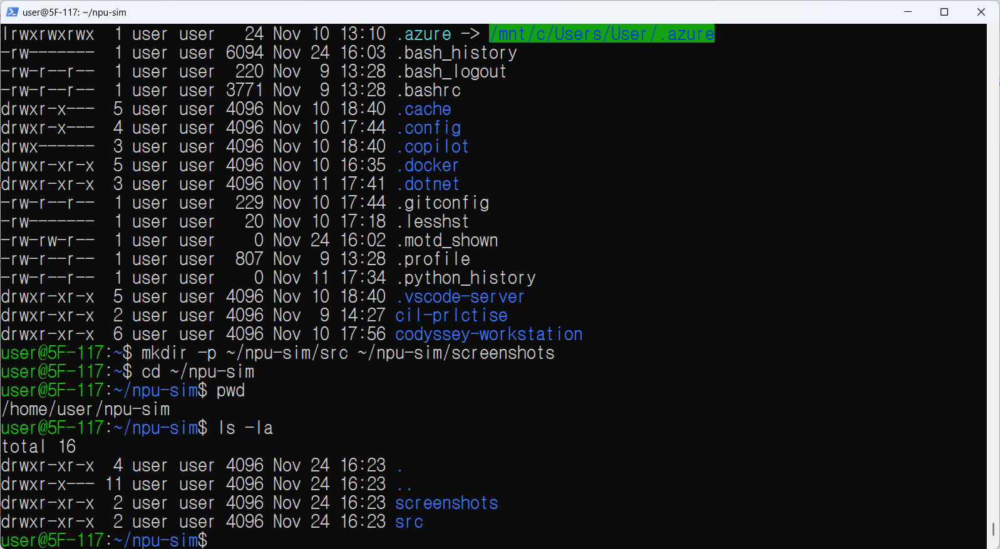

**03. 행렬 생성 및 접근 기능 테스트**

`make_matrix`, `get_value`, `set_value` 함수를 테스트하여 행렬 생성과 원소 읽기 및 변경 기능을 확인했습니다.

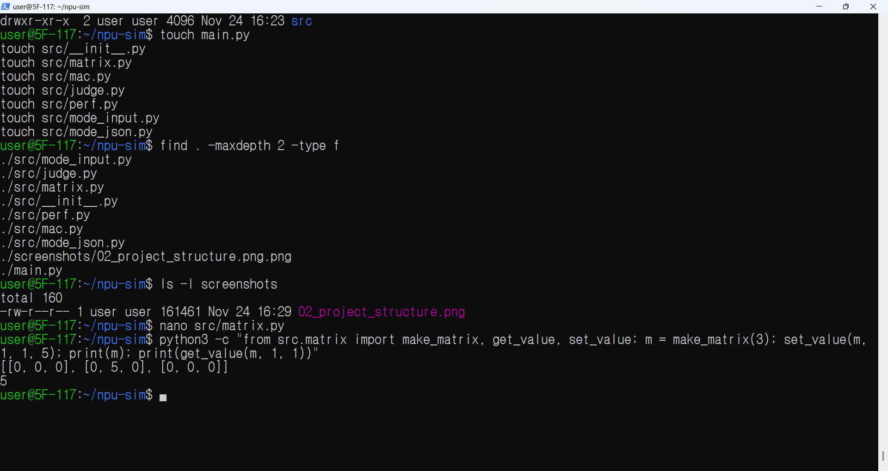

**04. MAC 연산 기능 테스트**

동일한 위치의 행렬 원소를 곱하고 합산하는 MAC 연산이 정상적으로 수행되는지 확인했습니다.

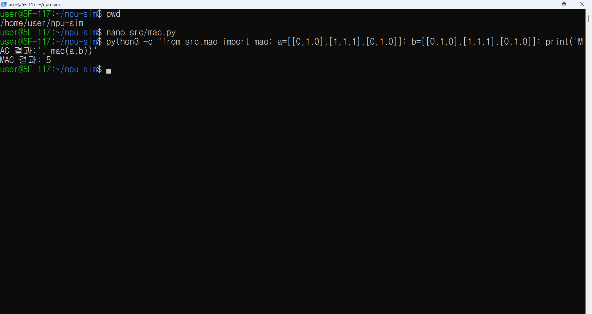

**05. 패턴 판정 기능 테스트**

Cross와 X 패턴의 점수를 비교하여 판정하는 기능을 테스트했습니다.

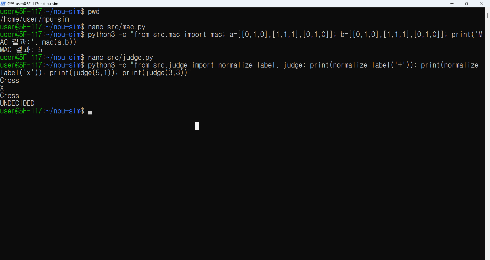

**06. 성능 측정 기능 테스트**

3×3, 5×5, 13×13, 25×25 행렬의 MAC 연산 횟수와 평균 실행 시간을 측정했습니다.

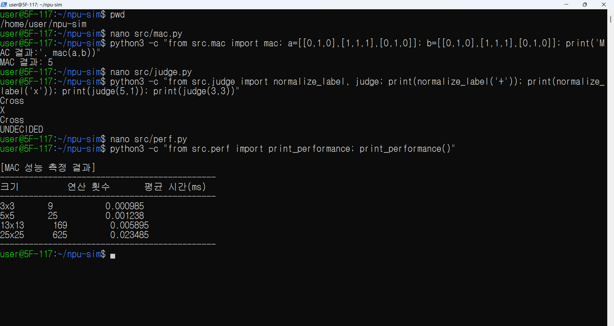

### 10-2. 사용자 입력 및 JSON 분석 기능

**07. 사용자 입력 모드 테스트**

Filter A, Filter B 및 입력 패턴을 직접 입력하고 각 필터의 MAC 점수와 판정 결과를 확인했습니다.

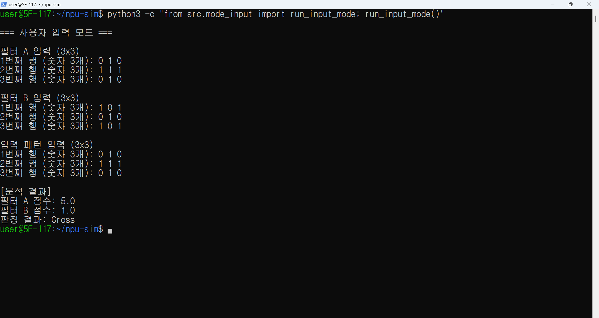

**08. JSON 데이터 검증 테스트**

JSON 데이터의 구조와 배열 크기 등 데이터 유효성 검증 기능을 확인했습니다.

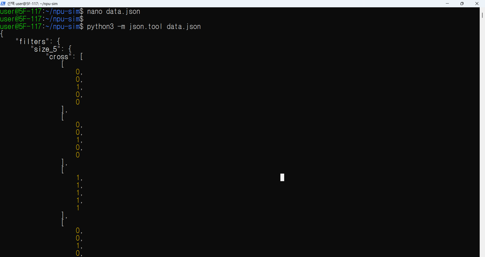

**09. JSON 분석 기능 테스트**

JSON 파일에 저장된 필터와 패턴 데이터를 불러와 MAC 연산 및 판정 결과를 확인했습니다.

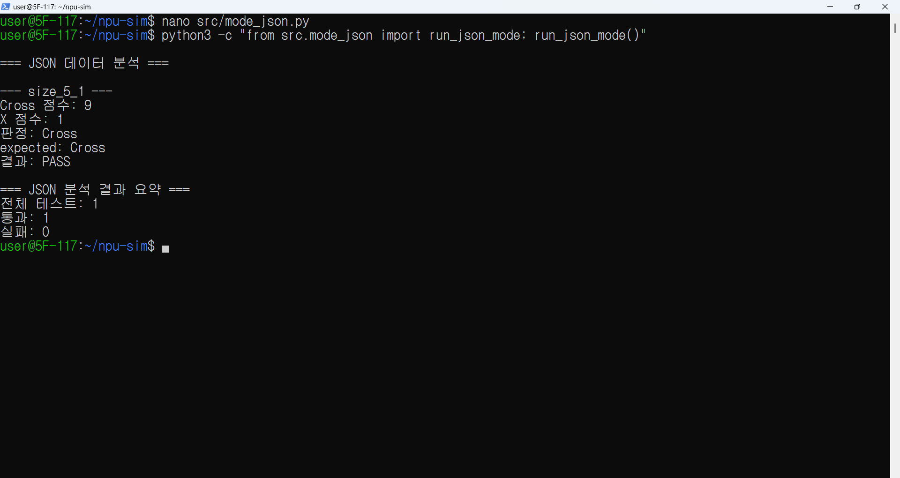

**10. 메인 프로그램 JSON 모드 테스트**

메인 메뉴에서 JSON 분석 모드를 선택하고 프로그램의 전체 실행 흐름을 확인했습니다.

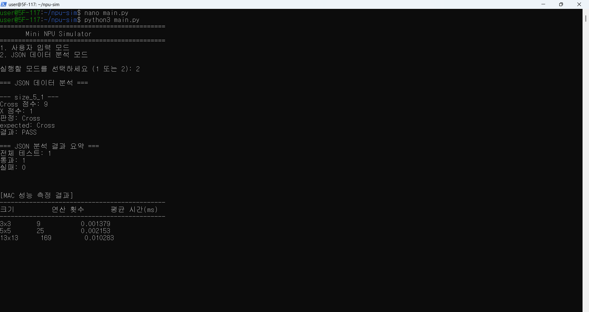

**11. 메인 프로그램 사용자 입력 모드 테스트**

메인 메뉴에서 사용자 입력 모드를 선택하고 입력부터 최종 판정까지의 실행 과정을 확인했습니다.

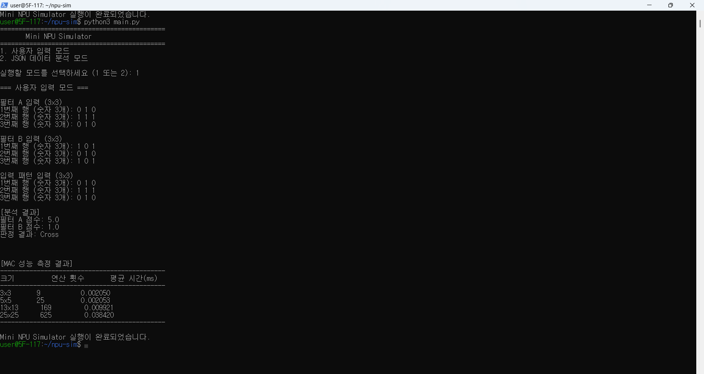

### 10-3. 라벨 정규화 및 최종 실행 검증

**12. 판정 라벨 표준화 테스트**

`+`, `cross`, `plus`를 Cross로, `x`, `ex`를 X로 표준화하는 기능을 확인했습니다.

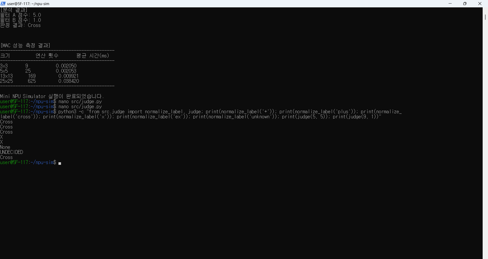

**13. JSON 필터 라벨 정규화 테스트**

JSON 필터에 사용된 다양한 라벨 표현을 표준 라벨로 변환하여 필터를 정상적으로 찾는지 확인했습니다.

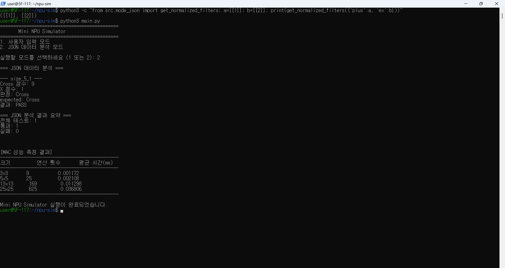

**17. 최종 JSON 분석 실행 결과**

JSON 분석 모드에서 테스트 케이스의 점수, 판정, PASS/FAIL 및 최종 결과 요약을 확인했습니다.

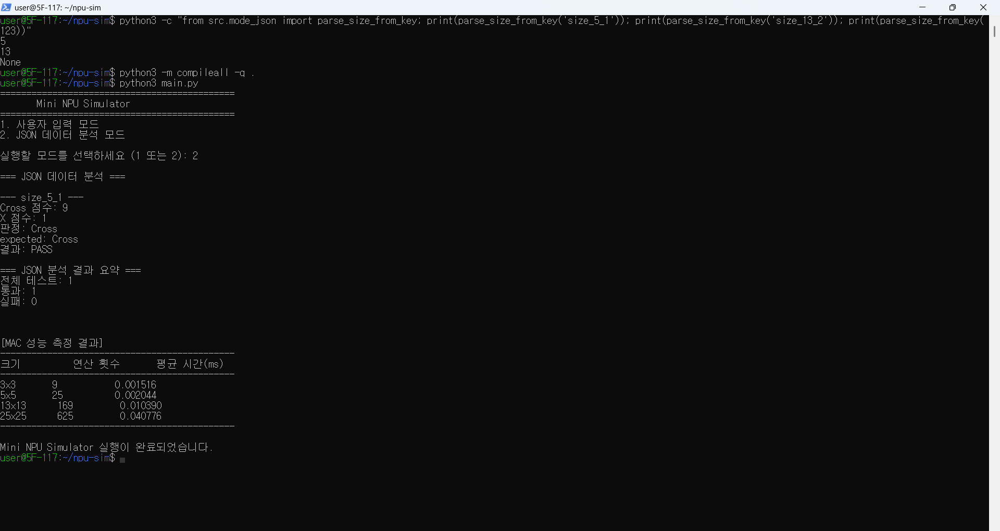

**18. 최종 사용자 입력 실행 결과**

사용자 입력 모드에서 Filter A와 Filter B의 점수를 계산하고 최종 Cross 판정 결과를 확인했습니다.

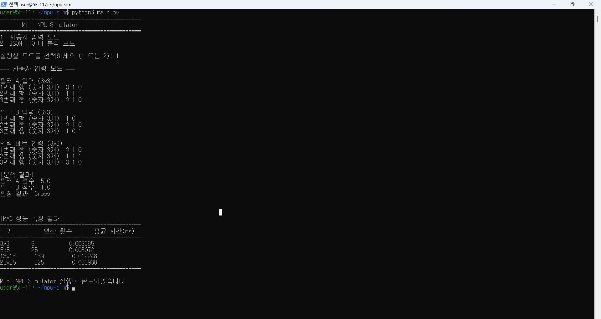

**19. GitHub 저장소 제출 확인**

프로젝트 파일과 README가 GitHub 저장소에 업로드된 것을 확인했습니다.

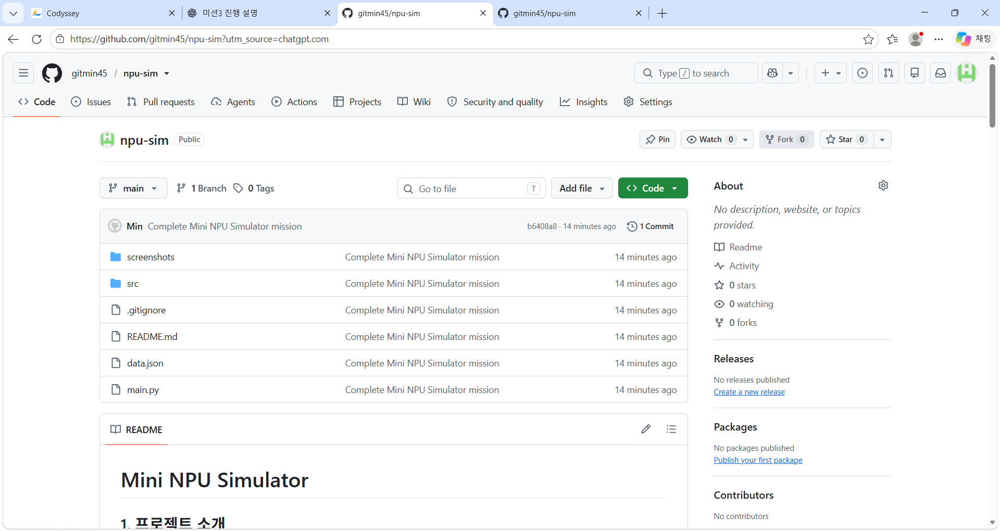

**20. 사용자 입력 모드 MAC 실행 시간 측정**

사용자 입력 모드에서 Filter A와 Filter B의 MAC 점수뿐 아니라 각 연산의 실행 시간과 평균 실행 시간을 측정했습니다.

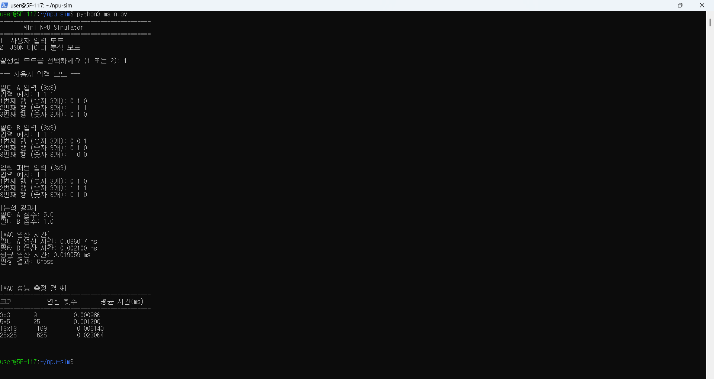

### 10-4. 검증 결과

총 16개의 스크린샷을 통해 프로젝트 구성, 기본 함수 구현, MAC 연산, 패턴 판정, 사용자 입력, JSON 데이터 검증, 성능 측정 및 GitHub 업로드 과정을 확인할 수 있습니다.

## 11. 프로젝트 결과

Mini NPU Simulator의 기본 MAC 연산, 패턴 판정, 사용자 입력, JSON 분석, 오류 처리 및 성능 측정 기능을 구현하고 실제 실행을 통해 동작을 확인했습니다.
